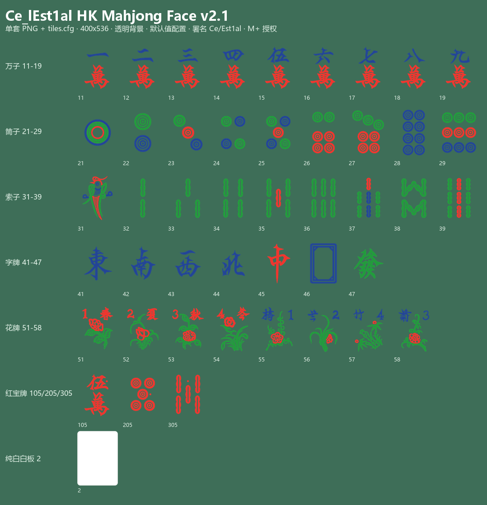

# Ce_lEst1al HK Mahjong Face v2.1 麻将牌面

为 salasasa 麻将平台设计的港式麻将牌面（含红宝牌）。v2.1 起适配平台新格式：
**2D 手牌与 3D 牌面共用同一套原图**，压缩包根目录直接放按牌面代号命名的 PNG
与一个 `tiles.cfg`，配置采用默认值（不移动、不缩放）。

底稿参照市面多厂家通行的传统样式实体麻将（公有领域传统图案），由作者以自摄
实物照片为基础重新抠图、绘制与上色。

署名：**Ce/Est1al**（署名处不支持斜杠的场合使用 `Ce_lEst1al`）



## 内容结构

```
Ce_lEst1al_HK_Mahjong_Face_v2.1/
├── readme.md                  本说明
├── LICENSE                    M+ 授权条款
├── preview.png                全套牌面预览图
├── tiles.cfg                  平台配置（默认值）
├── 2.png                      纯白白板
├── 11.png ~ 305.png           按牌面代号命名的单套牌面
└── Ce_lEst1al-HKv2.1.zip      salasasa 平台直传包
```

压缩包 `Ce_lEst1al-HKv2.1.zip` 内**仅含** 46 张 PNG 与 `tiles.cfg`，
全部位于根目录，无子文件夹、无其他文件。

- 全部图像为 400×536 透明背景 PNG，保留原始比例与透明通道，未拉伸、未二次压缩。
- 单套原图默认采用手牌牌面（图案原始大小、整体下移 14px）。
- `tiles.cfg` 中 `[2d]` / `[3d]` 均为 `x = 0`、`y = 0`、`scale = 100`；
  如需微调，可修改整包节，或添加 `[2d.11]`、`[3d.11]` 这样的单牌节（叠加生效）。
- 通用花牌 59 本套未提供，按平台规则由官方牌面自动递补。

## 牌面命名约定

| 编号 | 内容 |
| --- | --- |
| 11-19 | 万子：一万至九万（105 为红宝牌·红五万） |
| 21-29 | 筒子：一筒至九筒（205 为红宝牌·红五筒） |
| 31-39 | 索子：一索至九索（305 为红宝牌·红五索） |
| 41-44 | 风牌：東、南、西、北（蓝） |
| 45-47 | 箭牌：45 红中、46 白（蓝框）、47 發（绿） |
| 51-58 | 花牌八张：春/夏/秋/冬（红色数字）与 梅/兰/竹/菊（蓝色数字）两组 |
| 59 | 通用花牌（本套未提供，平台以官方牌面递补） |
| 2 | 纯白白板 |
| 105 / 205 / 305 | 红五万 / 红五筒 / 红五索 |

## 来源与创作说明

- 牌面底稿为公有领域的传统通行样式：万、条、筒、字牌、花牌的基础概念与
  通用视觉样式沿用已久，不存在在先权利人；
- 全部牌面由作者参照实体麻将照片重新绘制、抠图与上色，并非对任何现有
  数字素材或设计师款牌面的复制；
- 自定配色与红宝牌（105/205/305）设计为作者原创。

## 许可

见 [LICENSE](LICENSE)：采用 M+ 授权条款释放——可自由使用、复制、分发与修改，
不论是否修改过、不论商业或非商业用途，均属许可，无任何保证。

## salasasa 平台规约符合性

平台要求上传内容须由上传者拥有版权，或取得明确允许非商业使用和公开分享的
许可证。本套牌面满足要求：牌面为作者独创再创作（公有领域传统底稿 + 作者
重绘、配色、红宝牌设计），著作权由作者（Ce/Est1al）拥有；所附 M+ 授权条款
明确允许非商业使用、公开分享（乃至商业使用）。

## 规格自检

| 项目 | 平台要求 | 本包 |
| --- | --- | --- |
| PNG 单边 | ≤ 4096 px | 400 × 536 |
| 牌面单张 | ≤ 4 MB | 最大约 63 KB |
| 压缩包 / 解压后总大小 | ≤ 128 MB | 1.55 MB / 1.62 MB |

## 计划

- 补充通用花牌 59 与 SVG 矢量图版本；
- 扩充其他图案样式。

## 下载

- GitHub 仓库：（上传后填写地址）
- 百度网盘（v2.1）：[https://pan.baidu.com/s/1o0tJ7SQJs5a3BBEaUrCMIA?pwd=av84](https://pan.baidu.com/s/1o0tJ7SQJs5a3BBEaUrCMIA?pwd=av84)　提取码: `av84`
